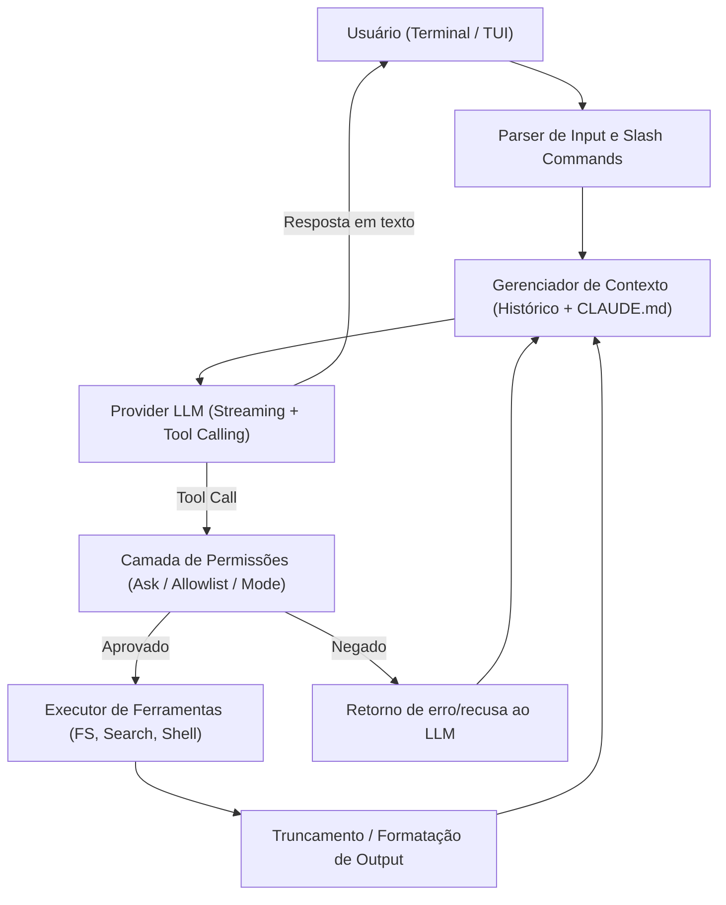

# Claude Code (Experimental Clone)

Projeto experimental para recriar um **agente de programação autônomo no terminal** inspirado no Claude Code — conectando LLMs com suporte a *tool calling* a ferramentas locais de leitura, busca, edição cirúrgica e execução de comandos, com controle de permissões e gerenciamento de contexto.

> **Status:** Fase 0 — Documentação e Planejamento

---

## Visão Geral da Arquitetura



Para detalhes técnicos sobre cada camada, consulte [docs/ARCHITECTURE.md](docs/ARCHITECTURE.md).

---

## Roadmap de Desenvolvimento

O desenvolvimento está organizado em 5 fases incrementais (detalhes em [docs/ROADMAP.md](docs/ROADMAP.md)):

1. **Fase 1 — MVP (Loop Agêntico Mínimo):** REPL no terminal com streaming, histórico e 3 ferramentas essenciais (`read_file`, `write_file`, `run_command`) com confirmação `[s/N]`.
2. **Fase 2 — Exploração e Edição Inteligente:** `glob`, `grep_search`, edição por diff (`edit_file`) com validação de unicidade e preview colorido no terminal.
3. **Fase 3 — Permissões, Segurança e Contexto:** Modos (`ask`, `auto-edit`, `plan`), proteção contra *path traversal*, memória via `CLAUDE.md`, truncamento de outputs e comando `/compact`.
4. **Fase 4 — TUI e Slash Commands:** Renderização de Markdown, syntax highlighting, spinners, barra de status e modo headless (`-p`).
5. **Fase 5 — Recursos Avançados (Experimentos):** Checkpoints (`/undo`), subagentes isolados para pesquisa e cliente MCP (Model Context Protocol).

---

## Estrutura Planejada

```text
.
├── docs/
│   ├── ARCHITECTURE.md    # Especificação técnica das camadas
│   └── ROADMAP.md         # Checklist detalhado das 5 fases
├── src/
│   ├── core/              # Loop agêntico, contexto e system prompts
│   ├── providers/         # Abstração de LLMs (streaming + tool calling)
│   ├── tools/             # Ferramentas locais (fs, search, shell)
│   ├── permissions/       # Políticas de aprovação e guardrails
│   └── ui/                # CLI, TUI, renderização de diffs e slash commands
├── tests/                 # Testes unitários e de integração
├── CLAUDE.md              # Instruções e convenções do projeto
└── README.md
```
